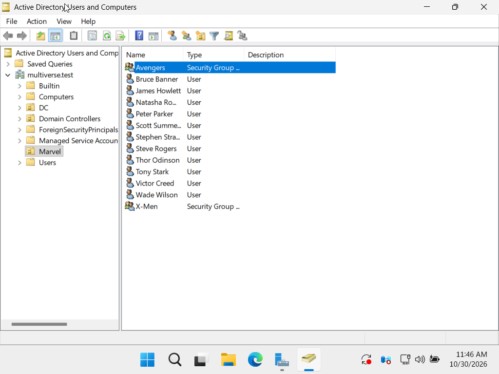
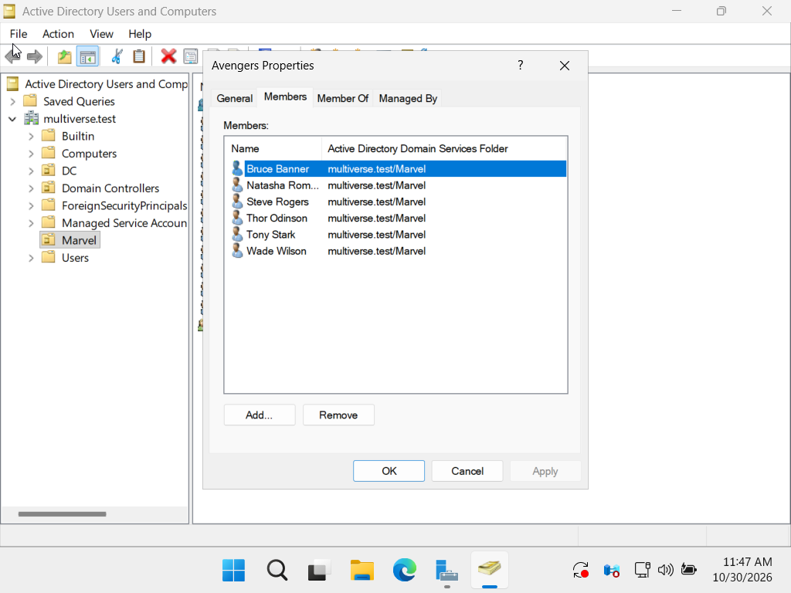
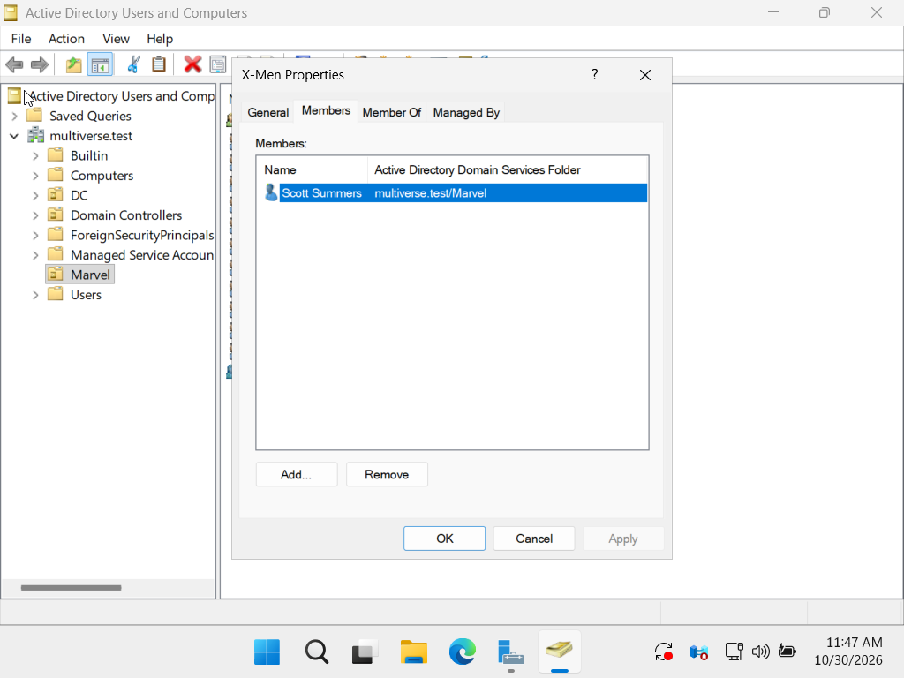
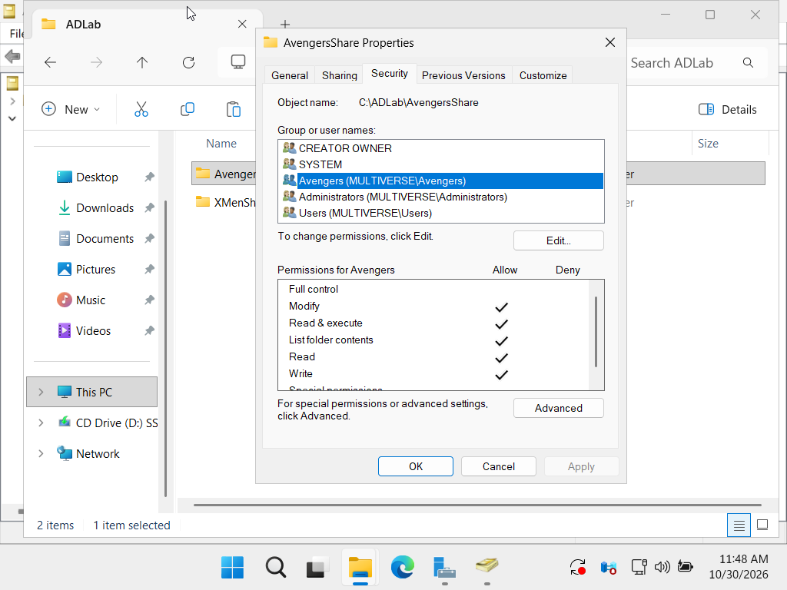
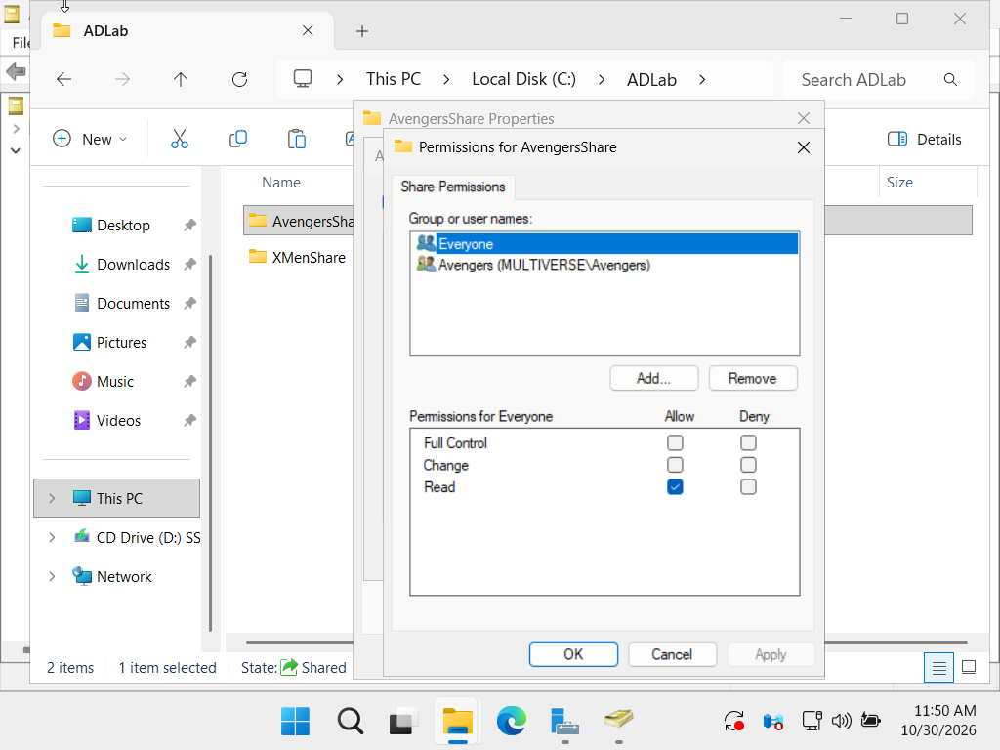
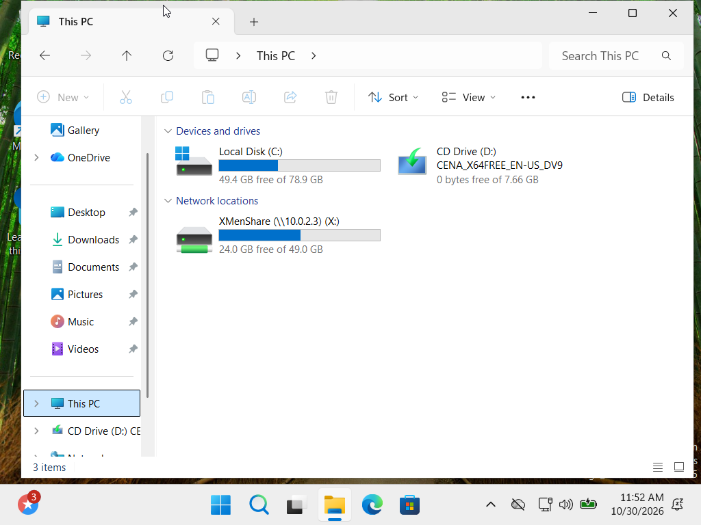
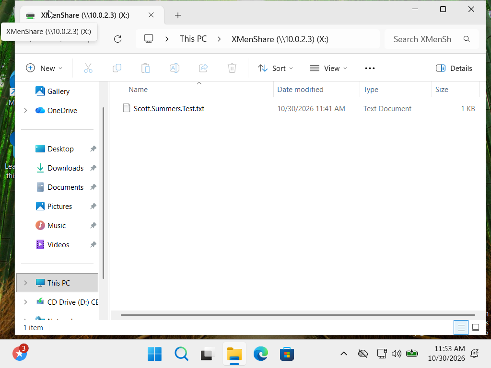
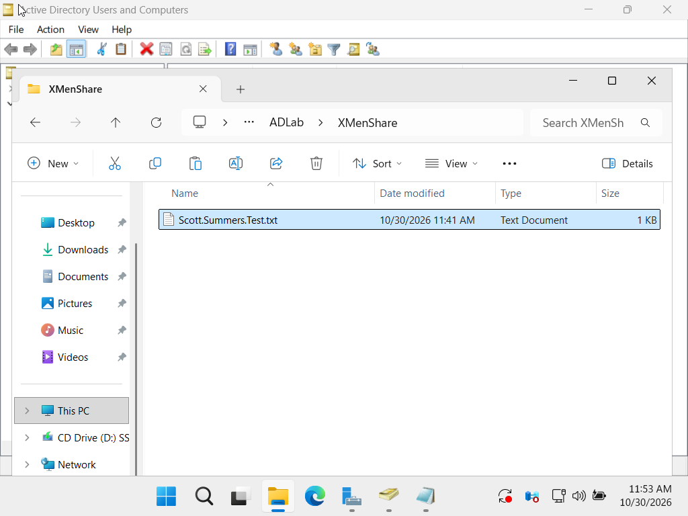

# Active Directory Group-Based File Access Lab

A hands-on Windows Server and Windows 11 lab demonstrating how Active Directory users, organizational units, security groups, NTFS permissions, SMB share permissions, and mapped drives work together.

## Lab environment

- **Domain:** `multiverse.test`
- **Domain controller:** Windows Server 2025
- **Client:** Windows 11 Enterprise
- **Virtualization:** Oracle VirtualBox using a shared NAT Network
- **Test shares:** `AvengersShare` and `XMenShare`

> All names and accounts in this lab are fictional. No passwords or production credentials are included.

## What I built

1. Promoted Windows Server 2025 to a domain controller and created the `multiverse.test` domain.
2. Created **Marvel** and **DC** organizational units to organize directory objects.
3. Created domain user accounts and two **Global Security** groups: **Avengers** and **X-Men**.
4. Added users to groups. For example, the Avengers group includes Bruce Banner, Natasha Romanoff, Steve Rogers, Thor Odinson, Tony Stark, and Wade Wilson. Scott Summers is a member of X-Men.
5. Created shared folders and assigned access through groups:
   - `C:\ADLab\AvengersShare` — Avengers has **Modify** NTFS permission.
   - `C:\ADLab\XMenShare` — configured for the X-Men group and used for the client access test.
6. Joined the Windows 11 client to `multiverse.test`, signed in as Scott Summers, and mapped the X-Men share as drive **X:**.
7. Created `Scott.Summers.Test.txt` from the Windows 11 mapped drive and confirmed that the same file appeared in the server’s `C:\ADLab\XMenShare` folder.

## Key concepts demonstrated

- **OU placement and group membership are different:** OUs organize directory objects and can be used for Group Policy scope or delegated administration. A user’s OU does not automatically grant file access.
- **Security groups simplify access management:** Permissions are assigned to a group; users receive those permissions through group membership.
- **NTFS and share permissions are separate controls:** NTFS permissions apply to the folder on the server. Share permissions apply when the folder is accessed over the network. Network access is limited by the combination of both.
- **A mapped drive is a convenient pointer:** Drive X: points to the server’s shared folder. Files created or edited there are stored on the server.

## Evidence

### Active Directory users and groups

### Folder and share permissions

### Client access test

## Result

This lab verified the workflow from directory setup to file access: create users, organize them with OUs, grant access through security-group membership, configure folder and share permissions, join a client to the domain, map the share, and confirm that client-side file changes are stored on the server.
